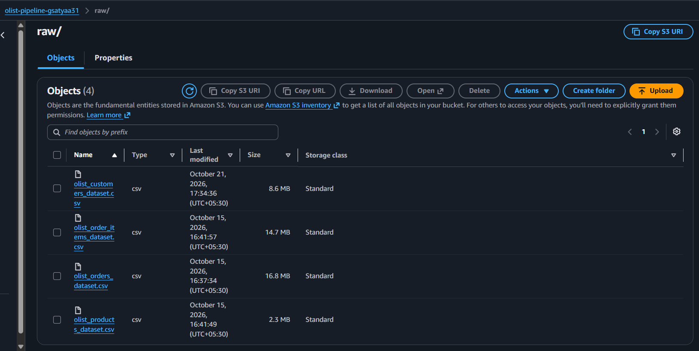
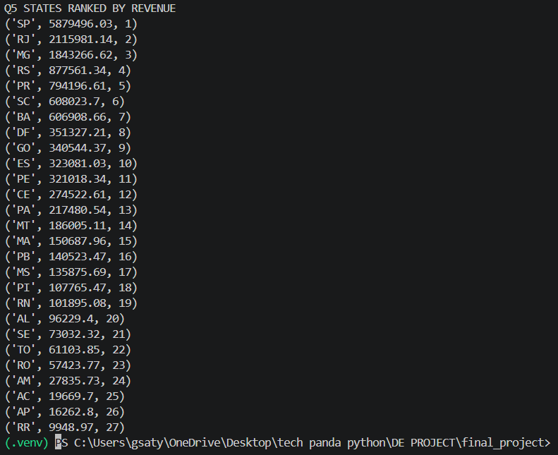

# End-to-End E-Commerce Sales Analytics Pipeline on AWS

## 1. Problem statement
An online retailer receives daily order, customer and product files as CSV. The raw data has duplicates, null values and inconsistent date/number formats. The business needs clean, reliable reports on daily sales, top products, top customers and state-wise revenue.

This project builds an AWS pipeline that stores raw files in S3, validates them with Lambda, cleans and joins them with PySpark, saves them in a layered S3 data lake (raw, processed, curated), and loads the final reports into RDS MySQL for SQL analysis.

**Dataset:** Olist Brazilian E-Commerce (Kaggle): orders, customers, products, order_items.

## 2. Architecture
See `architecture.pdf`.

```
Olist CSVs -> S3 raw/ -> (S3 event) -> Lambda validator -> rejected/ (invalid)
                |
                v  Boto3 download
        PySpark: clean + join (+ total_amount)
                |
                v
        S3 processed/ (Parquet, year/month)
                |
                v  Pandas aggregations
        S3 curated/ (4 tables)      S3 reports/ (data quality CSV)
                |
                v  Pandas + SQLAlchemy + PyMySQL
        RDS MySQL (salesdb) -> 5 SQL business queries
```

Region: Asia Pacific (Sydney) `ap-southeast-2`. The account was restricted to this region, so every service was created there.

## 3. Steps followed
1. **S3 setup:** bucket with `raw/`, `processed/`, `curated/`, `rejected/`, `reports/`.
2. **Upload raw:** 4 CSVs uploaded to `raw/` with Boto3.
3. **Download raw:** files downloaded back with Boto3; row counts checked (orders 99,441; customers 99,441; products 32,951; order items 112,650).
4. **Clean:** duplicates removed (0 found), nulls handled, dates and numbers converted, 625 `canceled` orders removed.
5. **Join (PySpark):** order_items + orders + customers + products, `total_amount = price + freight_value` -> 112,108 rows.
6. **Processed zone:** Parquet partitioned by year and month (24 files) uploaded to `processed/`.
7. **Curated zone:** daily sales, top 20 products, top 20 customers, monthly revenue by state, uploaded to `curated/`.
8. **Data quality report:** rows, duplicates, null cells and null % per raw dataset plus final row count, saved as CSV in `reports/`.
9. **RDS:** MySQL Free tier instance, database `salesdb`, 4 curated tables loaded with Pandas.
10. **SQL reporting:** 5 business queries (below).
11. **Lambda validation:** S3 trigger on `raw/`; checks extension, non-empty, expected file name and required columns; logs VALID/INVALID to CloudWatch; moves invalid files to `rejected/`.

### Reconciliation (proof nothing was lost)
- Order items: 112,650 - 542 (items of cancelled orders) = **112,108** joined rows.
- Total revenue is identical in raw, daily and monthly/state tables: **15,737,667.52**.

## 4. Null-handling justification

| Table | Column | Nulls | Choice | One-line justification |
|---|---|---|---|---|
| orders | order_approved_at | 160 | keep | Null means the order was not approved yet, which is real information. |
| orders | order_delivered_carrier_date | 1,783 | keep | Order not handed to the carrier yet. |
| orders | order_delivered_customer_date | 2,965 | keep | Not delivered yet; revenue does not depend on it. |
| products | product_category_name | 610 | fill "unknown" | Keeps these products' sales in category reports instead of losing revenue. |
| products | name/description length, photos qty | 610 | keep | Not used in any report. |
| products | weight and size columns | 2 | keep | Not used in any report. |
| customers, order_items | all columns | 0 | none | No nulls. |

## 5. Data quality report (raw data)

| Dataset | Rows | Duplicate rows | Null cells | Null % |
|---|---|---|---|---|
| orders | 99,441 | 0 | 4,908 | 0.62 |
| customers | 99,441 | 0 | 0 | 0.0 |
| products | 32,951 | 0 | 2,448 | 0.83 |
| order_items | 112,650 | 0 | 0 | 0.0 |
| final cleaned/joined | 112,108 | | | |

## 6. SQL queries and results
Tables in RDS: `daily_sales`, `top_products`, `top_customers`, `monthly_state_revenue`.

```sql
-- 1. Total revenue per month
SELECT year, month, ROUND(SUM(revenue),2) AS total_revenue
FROM monthly_state_revenue GROUP BY year, month ORDER BY year, month;

-- 2. Top 5 products by revenue
SELECT product_id, product_category_name, revenue
FROM top_products ORDER BY revenue DESC LIMIT 5;

-- 3. Top 10 customers by spend
SELECT customer_unique_id, total_spend
FROM top_customers ORDER BY total_spend DESC LIMIT 10;

-- 4. Day with the highest sales
SELECT order_date, num_orders, revenue
FROM daily_sales ORDER BY revenue DESC LIMIT 1;

-- 5. Rank states by total revenue
SELECT customer_state, ROUND(SUM(revenue),2) AS total_revenue,
       RANK() OVER (ORDER BY SUM(revenue) DESC) AS revenue_rank
FROM monthly_state_revenue GROUP BY customer_state ORDER BY revenue_rank;
```

Key results:
- Highest-revenue month: 2017-11 reached 1,172,191.68 (peak months in 2018 were about 1.15 million).
- Top product: `bb50f2e236e5eea0100680137654686c` (beleza_saude), 67,606.10.
- Top customer: `0a0a92112bd4c708ca5fde585afaa872`, 13,664.08.
- Best day: 2017-11-24 with 1,166 orders and 178,377.63 revenue.
- Top state: SP 5,879,496.03, then RJ 2,115,981.14 and MG 1,843,266.62.

## 7. Key design decisions
- **Orders per day use distinct `order_id`** because one order has several item rows.
- **Customers grouped by `customer_unique_id`** because `customer_id` changes with every order.
- **Join starts from `order_items`** so one row = one item, the grain needed for revenue.
- **SUM ignores nulls**, so a failed type cast would silently under-count; reconciliation totals guard against this.
- **Partition by year and month** so queries read only the months they need.
- **Curated stored as Parquet** to preserve types; the quality report is CSV as the brief requires.
- **Lambda trigger limited to `raw/`** to avoid a loop when invalid files are moved to `rejected/`.
- **Lambda reads only the first 4 KB** of each file to check the header, keeping runs ~300 ms within the 3 s / 128 MB limits.

## 8. Lambda validation test
- Valid file `olist_customers_dataset.csv` -> log `VALID`.
- Wrong file `wrong_file.csv` -> log `INVALID: file name is not one of the 4 expected files`, moved to `rejected/`.

## 9. Challenges faced
- Account restricted to Sydney; Mumbai unavailable.
- Typos in folder and column names (`download_raw` vs `downloaded_raw`, `orders_date` vs `order_date`).
- Spark on Windows: Python worker not found (fixed by setting `PYSPARK_PYTHON`) and `winutils.exe` missing, so Spark's native Parquet writer failed; the joined data was written with PyArrow instead.
- Reconciliation showed cancelled orders did have items (542), correcting an early assumption.
- Home IP changed repeatedly, causing RDS timeouts until the security group rule was updated.
- Lambda typos (`Body`, `Key`, `statusCode`) only surfaced at run time.
- Access key was exposed during the session; handled by deleting the key at cleanup.

## Screenshots
| # | What it shows |
|---|---|
| 01-05 | S3 bucket with `raw/`, `processed/`, `curated/`, `rejected/`, `reports/` and their contents |
| 06 | RDS tables in `salesdb` |
| 07-09 | Results of the 5 SQL queries |
| 10-11 | Lambda `olist-file-validator` and its S3 trigger |
| 12 | `wrong_file.csv` moved to `rejected/` by Lambda |
| 13 | RDS instance deleted (cleanup) |




## 10. Cleanup
RDS instance deleted (`13_rds_deleted.png`), IAM access key deleted, downloaded key file removed.

## 11. Files
`config.py`, `upload_raw.py`, `download_raw.py`, `inspect_data.py`, `clean_data.py`, `join_data.py`, `upload_processed.py`, `curated.py`, `data_quality.py`, `load_rds.py`, `sql_reports.py`, `test_lambda.py`, `lambda_function.py`; screenshots `01`-`13`.
